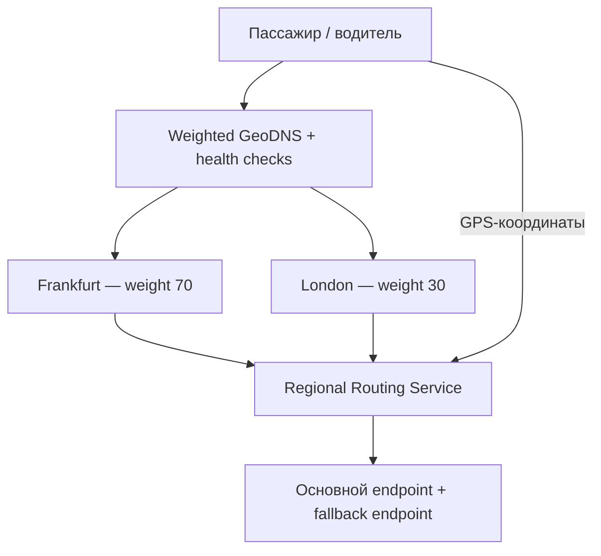
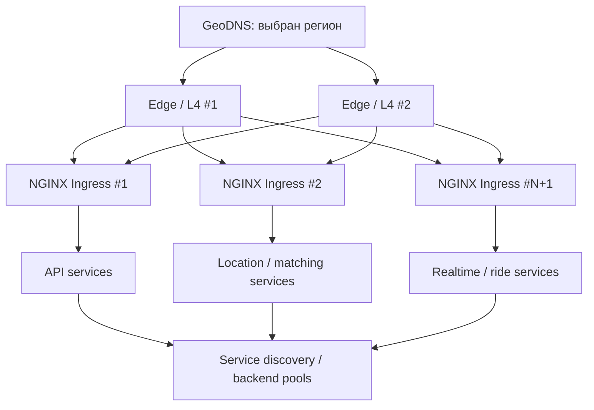
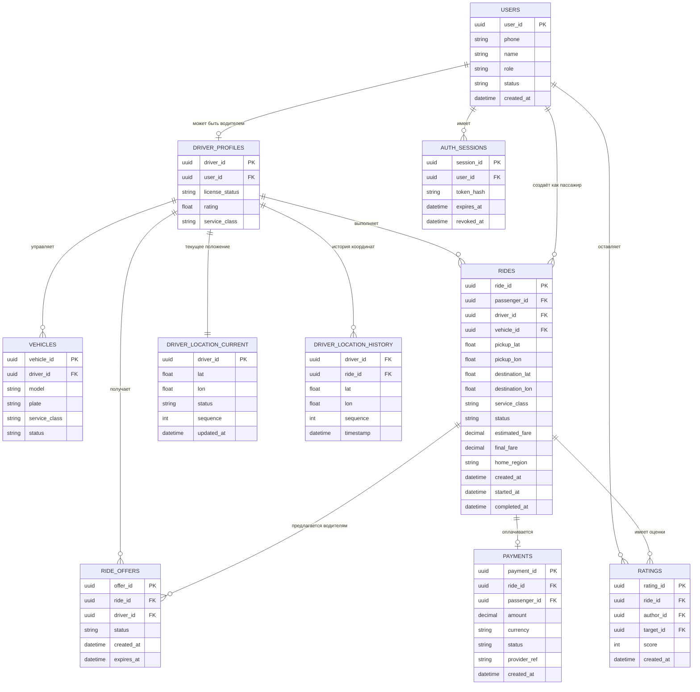
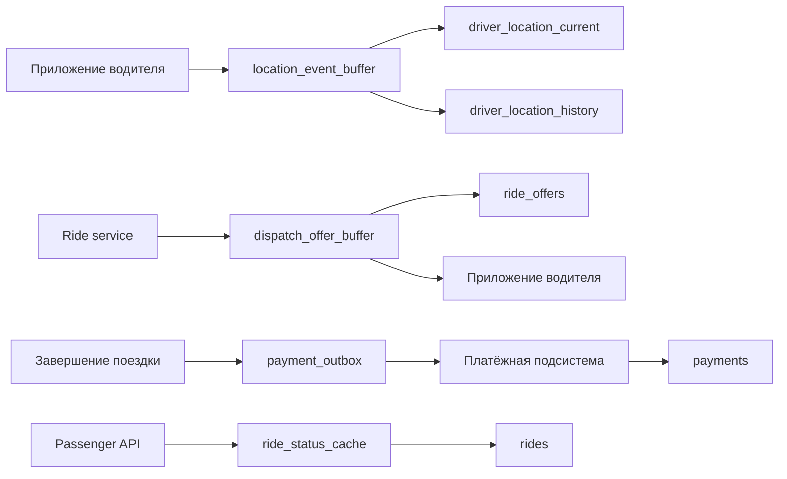
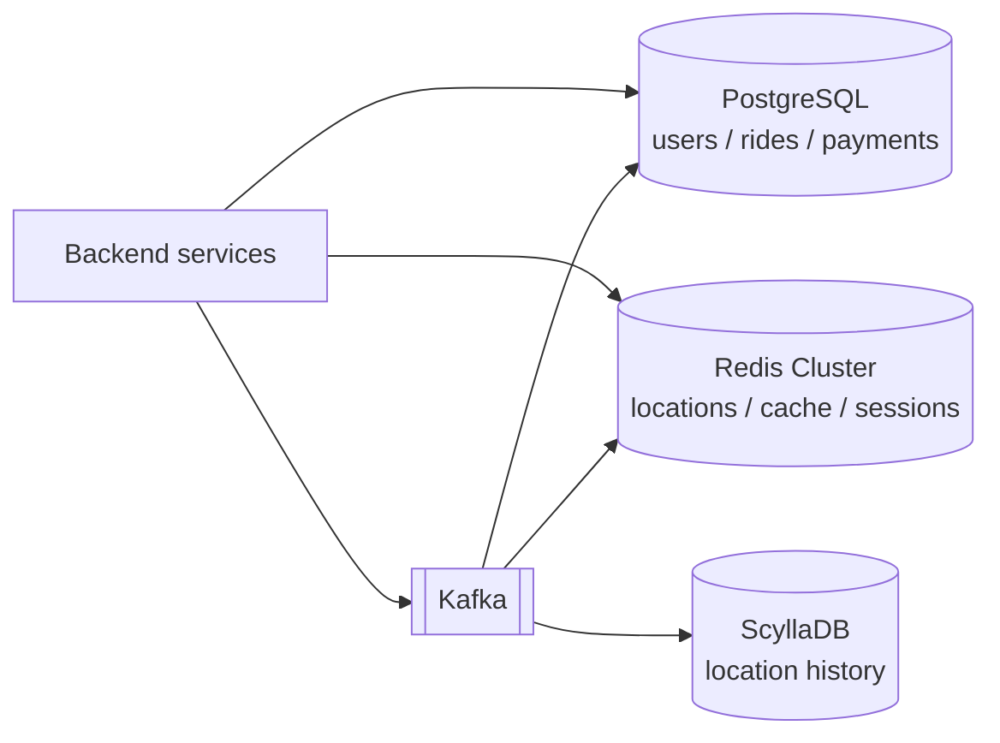

# Расчётно-пояснительная записка для курсовой работы по предмету «Проектирование высоконагруженных систем»

## 1. Тема и целевая аудитория

Тип сервиса: сервис онлайн-заказа такси (аналог Uber)

В рамках проекта рассматривается высоконагруженный сервис, аналогичный Uber, который связывает пассажиров и водителей такси - пассажир задаёт точки отправления и назначения, получает предварительную стоимость и ETA, создаёт заказ, после чего система подбирает подходящего свободного водителя поблизости и сопровождает поездку до завершения.

Так как на данный момент Uber является суперапом по типу Яндекс Go, было принято решение ограничить функционал только частью связанной с заказом такси. 

На рынке есть крупные сервисы, такие как Lyft, DiDi и Bolt за рубежом, и ЯндексGo и Ситимобил в России. Uber работает в 74 странах и более чем в 15 000 городах, что говорит о распределении целевой аудитории по всему миру [2].

### Целевая аудитория

Проектируемый сервис рассчитан на глобальную аудиторию крупных и средних городов.

| Параметр | Значение |
|---|---|
| География | Северная и Южная Америка, Европа, Азия и другие регионы присутствия сервиса |
| Месячная аудитория | около 100 млн пассажиров MAU для сервиса такси (оценка) |
| Целевая группа водителей | около 5 млн водителей MAU (оценка) |
| Основные клиенты | мобильное приложение пассажира и мобильное приложение водителя |
| Масштаб | международный высоконагруженный сервис |

Оценка аудитории такси получена из 208 млн MAPC всей платформы Uber за II квартал 2026 года [1] при допущении, что на поездки приходится примерно половина аудитории. Uber не публикует здесь отдельный MAU только для такси; точность оценки ограничена.

Основные группы пользователей:

1. Пассажиры — заказывают поездку из точки A в точку B.
2. Водители — принимают заказы и выполняют поездки.

### Ключевой функционал MVP

1. Регистрация и авторизация (+ мб верификация пользователя по коду из смс)
2. Формирование поездки - выбрать точки А и Б, класс машины, способ оплаты + доп опции
3. Поиск и назначение водителя.
4. Расчёт итоговой стоимости и оплата - после завершения поездки
5. Рейтинговая система — оценка пассажир-водитель и водитель-пассажир 
6. Отслеживание на карте

### Ключевые продуктовые решения

1. Подбор водителя по геопозиции — заказ предлагается ближайшим свободным водителям.
2. Динамический расчёт стоимости — цена рассчитывается до создания заказа на основе расстояния, времени поездки, выбранного тарифа и текущего спроса.
3. Отслеживание поездки в реальном времени — во время поиска машины и поездки пассажир получает актуальное местоположение автомобиля.
4. Автоматическое завершение и оплата — после окончания поездки система рассчитывает итоговую стоимость и автоматически списывает средства выбранным способом оплаты.
5. Двусторонняя рейтинговая система — после поездки пассажир может оценить водителя, а водитель — пассажира.


`Почему это хайлоад`

Uber сообщил о 3,867 млрд поездок и доставок за II квартал 2026 года, то есть в среднем около 42,5 млн операций в день по всей платформе (учитывая остальные сервисы суперапа Uber) [1]. Кроме пользовательских запросов, также создаются и системные запросы: активные водители постоянно передают координаты, пассажирские приложения обновляют состояние заказа, а система непрерывно выполняет геопоиск и сопоставление водителей и пассажиров.

## 2. Расчёт нагрузки

По отчёту Uber за II квартал 2026 года вся платформа имела 208 млн MAPC и 3,867 млрд завершённых поездок и доставок за 91 день. Отдельного числа поездок и активных пассажиров только для такси в отчёте нет. Для оценки принимаем долю такси 50%: около 100 млн пассажиров в месяц и 20 млн завершённых поездок в день (3,867 млрд / 91 × 50% ≈ 21,25 млн). Из 10 млн водителей и курьеров всей платформы за квартал [3] принимаем 5 млн водителей такси в месяц. Дневную аудиторию принимаем равной 15 млн пассажиров и 2 млн водителей.

Один водитель работает в среднем 8 часов в активный день, период координат — 4 секунды (сопоставимо с описанием Uber [4]), отслеживание заказа пассажиром длится 30 минут с обновлением раз в 10 секунд. Для выбора мощности принимаем пиковую часовую нагрузку в 3 раза выше среднесуточной скорости.

Часть исходных значений в этом разделе является не опубликованной статистикой Uber, а проектными допущениями. Значения 15 млн пассажиров DAU, 2 млн водителей DAU, 8 часов активности водителя, 30 минут отслеживания поездки, интервал отслеживания 10 секунд и коэффициент пика ×3 приняты для расчётной модели. Они нужны для перехода от публичных квартальных показателей Uber к нагрузке на конкретные методы API. После запуска реального сервиса эти коэффициенты должны уточняться по telemetry и фактическому суточному профилю нагрузки.

### Продуктовые метрики

| Метрика | Оценка для MVP такси | Основание |
|---|---:|---|
| Пассажиры, MAU | 100 млн | 50% от 208 млн MAPC всей платформы [1] |
| Пассажиры, DAU | 15 млн | 15% от MAU |
| Водители, MAU | 5 млн | около 50% от 10,2 млн водителей и курьеров [3] |
| Водители, DAU | 2 млн | 40% от MAU водителе |
| Завершённые поездки | 20 млн/сутки | около 50% от 3,867 млрд операций за 91 день [1] |
| Поездки на активного пассажира | 1,33/день | 20 млн / 15 млн DAU |
| Поездки на активного водителя | 10/день | 20 млн / 2 млн DAU |
| Расчёт предварительной цены | 2,67/активного пассажира в день | 2 расчёта на поездку; 40 млн/сутки |
| Создание заказа и оплата | по 1,33/активного пассажира в день | по 1 операции на поездку; по 20 млн/сутки |
| Оценки после поездки | 2/поездку | пассажир оценивает водителя и наоборот; 40 млн/сутки |
| Координаты водителя | 7 200/активного водителя в день | 8 ч × 3600 / 4 с; 14,4 млрд/сутки |
| Обновление состояния поездки пассажиру | 180/поездку | 30 мин × 60 / 10 с; 3,6 млрд/сутки |

В таблице RPS ниже дополнительно используется допущение, что до принятия заказа он в среднем предлагается двум водителям. Поэтому на 20 млн поездок приходится около 40 млн событий предложения заказа водителю в сутки. Размеры сетевых сообщений и записей в хранилище также являются проектной оценкой структуры данных, а не опубликованными внутренними форматами Uber.

**Средний объём данных на пользователя.** При хранении истории поездок год средний пассажир совершает 73 поездки (20 млн × 365 / 100 млн). На него приходится один профиль (1 КБ), 73 записи поездок (по 2 КБ), 73 платежа (по 0,5 КБ) и 73 оставленные оценки (по 0,2 КБ): всего около **198 КБ = 0,000198 ГБ**. 
Средний водитель выполняет 1 460 поездок за год (20 млн × 365 / 5 млн); его профиль и связанные записи поездок и оценок занимают примерно **3,2 МБ = 0,0032 ГБ** без дублирования поездок в общем хранилище. Геопозиции учитываются отдельно: на одного из 5 млн месячных водителей в среднем приходится 86 400 точек за 30 дней, или **0,00415 ГБ** при 48 байтах на точку. Эти оценки не включают карты и медиафайлы: их хранение не входит в MVP.

### Технические метрики

#### Хранение

| Тип данных | Срок хранения в модели | Количество записей | Размер записи | Полезный объём |
|---|---:|---:|---:|---:|
| Профили пассажиров и водителей | всё время работы сервиса | 105 млн | 1 КБ | 0,105 ТБ |
| Завершённые поездки и маршрут/стоимость | 1 год | 7,3 млрд | 2 КБ | 14,6 ТБ |
| Платёжные операции (без данных банковских карт) | 1 год | 7,3 млрд | 0,5 КБ | 3,65 ТБ |
| Оценки пассажиров и водителей | 1 год | 14,6 млрд | 0,2 КБ | 2,92 ТБ |
| История координат водителей | 30 дней | 432 млрд | 48 Б | 20,736 ТБ |
| **Итого полезных данных** | | | | **≈42,0 ТБ** |

Количество точек геопозиции: 2 млн активных водителей × 8 ч × 3600 / 4 с × 30 дней = 432 млрд. Для планирования физического хранилища при трёх копиях без учёта индексов и резервных копий требуется около **126 ТБ**.

#### Сетевой трафик

Указан прикладной трафик между мобильными клиентами и сервисом; средняя скорость = Гбайт/сутки × 8 / 86 400, пиковая = средняя × 3. Гигабайты и терабайты здесь десятичные. Загрузка карт из внешнего картографического сервиса не включена.

| Тип трафика | Расчёт | Гбайт/сутки | Пик, Гбит/с |
|---|---|---:|---:|
| Координаты водителей → сервер | 14,4 млрд сообщений × 200 Б | 2 880 | 0,80 |
| Состояние и местоположение машины → пассажир | 3,6 млрд ответов × 500 Б | 1 800 | 0,50 |
| Цена, заказ, назначение, оплата, оценки, авторизация | около 175 млн операций × в среднем 1 КБ | 175 | 0,049 |
| **Итого** | | **4 855** | **≈1,35** |

Для внешних сетевых интерфейсов нужен запас сверх 1,35 Гбит/с на TLS, HTTP, повторы, неравномерность по регионам и служебный обмен. Это глобальная сумма; региональная ёмкость зависит от распределения поездок по времени и географии.

#### RPS по основным методам

Средний RPS = число операций за сутки / 86 400; пиковый RPS = средний × 3. Выдача предложения водителю учитывается как событие сервера, остальные строки — запросы мобильного клиента или внутреннего сервиса. Округление сделано до целых запросов в секунду.

| Метод / событие | Операций в сутки | Средний RPS | Пиковый RPS |
|---|---:|---:|---:|
| `POST /fare-estimates` — предварительная цена | 40 млн | 463 | 1 389 |
| `POST /rides` — создание заказа | 20 млн | 231 | 694 |
| Предложение заказа водителю | 40 млн | 463 | 1 389 |
| `POST /drivers/location` — координаты | 14,4 млрд | 166 667 | 500 000 |
| `GET /rides/{id}/status` — отслеживание | 3,6 млрд | 41 667 | 125 000 |
| `POST /rides/{id}/complete` — завершение и оплата | 20 млн | 231 | 694 |
| `POST /ratings` — две оценки за поездку | 40 млн | 463 | 1 389 |
| `POST /auth/refresh` — один запрос на активного пассажира | 15 млн | 174 | 521 |
| **Итого** | **≈18,175 млрд** | **≈210 359** | **≈631 076** |

Расчёт платежа здесь означает запрос к собственному сервису; обращения к платёжному провайдеру могут иметь другой профиль нагрузки. Пик, усреднённый по всей глобальной системе, не означает одновременный пик во всех регионах.


## 3. Глобальная балансировка нагрузки

Для глобальной системы заказа такси критична задержка между мобильным клиентом и сервером: водитель постоянно передаёт координаты, пассажир получает обновления поездки, а подбор водителя должен работать в пределах того же географического региона. Поэтому трафик сначала направляется в ближайший работоспособный региональный дата-центр, после чего локальные балансировщики распределяют его между экземплярами сервисов.

Uber публично описывает инфраструктуру с edge-прокси, которые завершают TLS/QUIC ближе к пользователю и передают HTTPS-трафик в ближайший дата-центр [7]. В более позднем описании compute-платформы Uber также указывает, что дата-центры работают в active-active режиме и при региональном сбое трафик может быть перенаправлен в другой регион [6]. В проекте используется тот же общий принцип, но конкретные города и веса являются проектным решением.

### 3.1. Функциональное разбиение по доменам

| Домен | Назначение | Основной трафик из раздела 2 | Способ глобальной балансировки |
|---|---|---|---|
| `api.uber-clone.com` | Авторизация, предварительная цена, создание и завершение поездки, оценки | `fare-estimates`, `rides`, `complete`, `ratings`, `auth` | Weighted GeoDNS + dynamic endpoint |
| `driver.uber-clone.com` | Передача координат водителей и получение предложений заказов | `drivers/location`, события назначения | Weighted GeoDNS + привязка по GPS |
| `realtime.uber-clone.com` | Получение пассажиром состояния поездки и положения автомобиля | `rides/{id}/status` | Weighted GeoDNS + региональная привязка поездки |

Разделение доменов позволяет независимо масштабировать самый тяжёлый поток координат водителей, обычный HTTP API и realtime-трафик пассажиров. Все три домена в нормальном режиме направляют одного пользователя в один регион, чтобы состояние активной поездки не приходилось постоянно передавать между удалёнными регионами.

### 3.2. Размещение дата-центров

Точное распределение RPS Uber по регионам публично не раскрывается. Для расчётной модели используется опубликованное Uber распределение выручки за II квартал 2026 года по месту совершения транзакции [5] как proxy географического распределения нагрузки:

- US&CAN — 7,609 млрд долларов из 14,191 млрд, или **53,6%**;
- EMEA — 3,752 млрд долларов, или **26,4%**;
- APAC — 1,808 млрд долларов, или **12,7%**;
- LatAm — 1,022 млрд долларов, или **7,2%**.

Выручка не равна числу запросов: средняя стоимость поездки различается между странами. Поэтому эти доли используются только как начальные веса для архитектурной модели. В работающей системе веса должны корректироваться по фактическим поездкам, RPS, задержке и загрузке инфраструктуры.

Для каждого региона предусматривается основной и резервный ДЦ:

| Регион | Основной ДЦ | Резервный ДЦ | Доля глобальной нагрузки |
|---|---|---|---:|
| US&CAN | Ашберн | Орегон | 53,6% |
| EMEA | Франкфурт | Лондон | 26,4% |
| APAC | Сингапур | Мумбаи | 12,7% |
| LatAm | Сан-Паулу | Сантьяго | 7,2% |

Оба ДЦ региона могут принимать трафик в режиме active-active. Конкретные города являются проектным решением и не являются утверждением о фактическом расположении инфраструктуры Uber.

### 3.3. Распределение запросов по регионам

Региональная пиковая нагрузка рассчитывается по формуле:

`RPS региона = глобальный пиковый RPS × доля региона`

Глобальный пик из раздела 2 равен **≈631 076 RPS**, а глобальный прикладной сетевой трафик — **≈1,35 Гбит/с**.

| Регион | Доля | Пиковый RPS | Пиковый прикладной трафик |
|---|---:|---:|---:|
| US&CAN | 53,6% | ≈338 373 | ≈0,724 Гбит/с |
| EMEA | 26,4% | ≈166 852 | ≈0,357 Гбит/с |
| APAC | 12,7% | ≈80 402 | ≈0,172 Гбит/с |
| LatAm | 7,2% | ≈45 449 | ≈0,097 Гбит/с |
| **Итого** | **100%** | **≈631 076** | **≈1,35 Гбит/с** |

Распределение пикового RPS по типам запросов:

| Метод / событие | US&CAN | EMEA | APAC | LatAm |
|---|---:|---:|---:|---:|
| `POST /fare-estimates` | 745 | 367 | 177 | 100 |
| `POST /rides` | 372 | 183 | 88 | 50 |
| Предложение заказа водителю | 745 | 367 | 177 | 100 |
| `POST /drivers/location` | 268 092 | 132 196 | 63 702 | 36 009 |
| `GET /rides/{id}/status` | 67 023 | 33 049 | 15 926 | 9 002 |
| `POST /rides/{id}/complete` | 372 | 183 | 88 | 50 |
| `POST /ratings` | 745 | 367 | 177 | 100 |
| `POST /auth/refresh` | 279 | 138 | 66 | 38 |
| **Итого** | **≈338 373** | **≈166 852** | **≈80 402** | **≈45 449** |

Из таблицы видно, что архитектуру определяет прежде всего поток координат водителей: около 79% пикового RPS приходится на `POST /drivers/location`.

### 3.4. Weighted GeoDNS и динамический endpoint

Для первичного подключения используется **Weighted GeoBased DNS** с health-check каждого ДЦ.

Сначала GeoDNS по географическому положению клиента определяет допустимый регион. Затем между работоспособными ДЦ этого региона запросы распределяются по весам.

Например, для EMEA:

```text
Frankfurt — weight 70
London    — weight 30
```

Это означает, что примерно 70% новых DNS-разрешений будут направлены во Франкфурт, а 30% — в Лондон. Вес может динамически уменьшаться при росте загрузки ДЦ.



Однако DNS используется только для **первичного входа в систему**. Мобильное приложение знает GPS-координаты пользователя значительно точнее, чем DNS.

После подключения приложение передаёт координаты в Global/Regional Routing Service. Routing Service учитывает:

- GPS-координаты пользователя;
- сетевую задержку;
- загрузку ДЦ;
- результаты health-check;
- регион активной поездки.

После этого клиент получает динамический endpoint, например:

```text
primary:  api-eu-frankfurt.uber-clone.com
fallback: api-eu-london.uber-clone.com
```

При создании поездке назначаются `home_region` и `home_dc`. Пассажир и водитель обслуживаются через этот ДЦ до окончания поездки. Это позволяет сохранять порядок событий и не переносить активное состояние между регионами при обычной балансировке.

Для DNS-записей принимается TTL **60 секунд**. DNS не выполняется для каждого API-запроса.

### 3.5. Запись данных и резервирование между ДЦ

Для каждой активной поездки определяется основной `home_dc`, который является владельцем её состояния. Это предотвращает одновременное конфликтующее изменение одной поездки в нескольких ДЦ.

При этом критичные данные реплицируются во второй ДЦ того же региона:

```text
Client
  ↓
Frankfurt — home_dc
  ↓ replication
London — резервная копия состояния
```

Между ДЦ реплицируются:

- создание поездки;
- назначение водителя;
- изменение состояния поездки;
- завершение поездки;
- информация о платеже.

Для координат водителей синхронная запись сразу в два ДЦ не используется из-за нагрузки до **500 000 обновлений/с**. Координата записывается в основной ДЦ и асинхронно передаётся в резервный через поток событий.

Таким образом, потеря отдельного обновления координаты допустима, поскольку через несколько секунд поступит следующая координата, тогда как потеря состояния поездки или платежа недопустима.

### 3.6. Failover между дата-центрами

Каждый ДЦ постоянно проходит health-check. Для определения состояния используются:

- доступность endpoint;
- error rate;
- latency;
- загрузка CPU;
- текущий RPS;
- состояние сетевой инфраструктуры.

В штатном режиме, например:

```text
Frankfurt — 70%
London    — 30%
```

При отказе Frankfurt:

```text
Frankfurt — unhealthy → исключается
London    — 100%
```

GeoDNS перестаёт возвращать IP отказавшего ДЦ для новых DNS-запросов.

Поскольку DNS-ответ может оставаться в кеше до истечения TTL, только DNS недостаточно для быстрого переключения уже работающего приложения. Поэтому Routing Service заранее передаёт клиенту `fallback endpoint`.

Если основной endpoint перестаёт отвечать:

1. клиент переключается на `fallback endpoint`;
2. резервный ДЦ становится владельцем активной поездки;
3. состояние восстанавливается из меж-ДЦ реплики;
4. дальнейшие запросы выполняются через резервный ДЦ.

Таким образом, **новые клиенты переключаются через GeoDNS**, а **уже подключённые клиенты — через fallback endpoint**, не ожидая истечения DNS TTL.

При полном отказе обоих ДЦ региона запрос может быть перенаправлен в ближайший доступный регион. Uber также описывает возможность межрегионального failover и необходимость наличия свободной вычислительной ёмкости в принимающем регионе [6].

После восстановления отказавшего ДЦ его вес увеличивается постепенно, например:

```text
0% → 10% → 30% → 50% → нормальный вес
```

Это предотвращает резкий скачок нагрузки.

Для создания и завершения поездки, а также платежных операций используются `idempotency keys`, поэтому повтор запроса после переключения между ДЦ не должен приводить к созданию второй поездки или повторному списанию.

## 4. Локальная балансировка нагрузки

Внутри каждого регионального дата-центра трафик проходит два уровня балансировки:

1. **L4 / сетевой уровень** — два независимых edge-узла принимают входящий трафик на виртуальный IP. Для этого уровня используется резервирование **N×2**: каждый сетевой узел должен быть способен принять весь входящий трафик дата-центра при отказе второго.
2. **L7 / прикладной уровень** — пул NGINX Ingress Controller завершает TLS и распределяет HTTP-запросы по экземплярам backend-сервисов. Для него используется резервирование **N+1**.



NGINX выполняет TLS termination и L7 routing. Backend-сервисы проектируются stateless относительно HTTP-соединения, поэтому специальная sticky-session балансировка им не требуется; состояние поездки хранится в соответствующих хранилищах. Для долгоживущего realtime-соединения один установленный connection естественно остаётся на выбранном экземпляре до переподключения.

### 4.1. Производительность одного L7-балансировщика

В методических материалах приведён benchmark NGINX Ingress Controller [8]. Для HTTPS на 16 CPU в тесте получено:

- **341 232 HTTPS RPS**;
- **56 715 SSL/TLS transactions per second**;
- **8,80 Гбит/с** throughput.

Benchmark является лабораторным и не учитывает всю production-логику. Поэтому в проекте балансировщик не загружается более чем на 70% от измеренного значения, то есть оставляется 30% запаса:

- допустимый RPS одного ingress: `341 232 × 0,7 ≈ 238 862 RPS`;
- допустимый TLS TPS: `56 715 × 0,7 ≈ 39 701 TPS`;
- допустимый сетевой трафик: `8,8 × 0,7 ≈ 6,16 Гбит/с`.

### 4.2. Расчёт по RPS

Число рабочих L7-балансировщиков:

`N = ceil(пиковый RPS дата-центра / 238 862)`

С учётом схемы N+1:

`N_total = N + 1`

| Региональный ДЦ | Пиковый RPS | Рабочих NGINX `N` | С резервом `N+1` |
|---|---:|---:|---:|
| US&CAN | 338 373 | 2 | **3** |
| EMEA | 166 852 | 1 | **2** |
| APAC | 80 402 | 1 | **2** |
| LatAm | 45 449 | 1 | **2** |
| **Всего** | **631 076** | **5** | **9 NGINX ingress** |

Проверка самого нагруженного региона после отказа одного ingress:

`338 373 / 2 ≈ 169 187 RPS < 238 862 RPS`

То есть три ingress-узла в US&CAN действительно удовлетворяют схеме N+1: при отказе одного оставшиеся два принимают региональный пик.

Для остальных регионов после отказа одного из двух ingress весь региональный пик остаётся ниже допустимых 238 862 RPS одного узла.

### 4.3. Проверка SSL/TLS termination

Точный показатель новых TLS-соединений Uber не раскрывается. Для расчётной модели принимается до **10 новых защищённых соединений на одного активного клиента в сутки**. Это учитывает повторные открытия приложения и переподключения мобильной сети, при этом HTTP/2/QUIC позволяют выполнять много запросов внутри одного соединения.

Активная аудитория: `15 млн пассажиров + 2 млн водителей = 17 млн DAU`.

Количество новых соединений:

`17 млн × 10 = 170 млн соединений/сутки`

Среднее:

`170 млн / 86 400 ≈ 1 968 TLS TPS`

Пик при коэффициенте ×3:

`1 968 × 3 ≈ 5 903 TLS TPS`

Для крупнейшего региона US&CAN:

`5 903 × 53,6% ≈ 3 165 TLS TPS`

Даже один NGINX с проектным ограничением **39 701 TLS TPS** имеет большой запас. Следовательно, SSL termination не определяет количество балансировщиков; ограничителем остаётся RPS.

### 4.4. Проверка пропускной способности сети

Глобальный прикладной пик из раздела 2 составляет около **1,35 Гбит/с**.

Максимум приходится на US&CAN:

`1,35 × 53,6% ≈ 0,724 Гбит/с`

Допустимая нагрузка одного ingress после 30% запаса составляет **6,16 Гбит/с**:

`0,724 Гбит/с < 6,16 Гбит/с`

Даже один ingress перекрывает расчётную сетевую нагрузку региона. Поэтому сеть также не является ограничителем количества L7-балансировщиков.

При реальном развёртывании интерфейсы и uplink должны иметь дополнительный запас на TCP/QUIC, TLS, служебный межсервисный трафик, репликацию и неучтённые повторы; здесь сравнивается именно прикладной внешний трафик из раздела 2.

### 4.5. Итог локальной балансировки

Для одного регионального дата-центра схема выглядит так:

`GeoDNS → 2× Edge/L4 → NGINX Ingress pool (N+1) → backend services`

Количество:

| Компонент балансировки | US&CAN | EMEA | APAC | LatAm | Итого |
|---|---:|---:|---:|---:|---:|
| Edge/L4, резервирование N×2 | 2 | 2 | 2 | 2 | **8** |
| NGINX Ingress, резервирование N+1 | 3 | 2 | 2 | 2 | **9** |

Таким образом, для нормального пикового режима необходимо **9 L7 NGINX ingress-узлов** по всем четырём регионам. Расчёт по RPS является определяющим; SSL TPS и пропускная способность сети имеют существенный запас.


## 5. Логическая схема БД


### 5.1. Основные сущности



### 5.2. Объём и нагрузка основных данных

В таблице используются средний и пиковый QPS. Для низкочастотных операций изменения профиля точная нагрузка не влияет на архитектуру и считается значительно меньшей нагрузки поездок.

| Сущность | Назначение | Количество / срок хранения | Размер записи | Объём | Чтение, avg / peak QPS | Запись, avg / peak QPS |
|---|---|---:|---:|---:|---:|---:|
| `users` | Учётные записи пассажиров и водителей | 105 млн | ≈0,9 КБ | ≈94,5 ГБ | ≈174 / 521 минимум для auth | значительно < 100 |
| `driver_profiles` | Данные водителя | 5 млн | ≈0,5 КБ | ≈2,5 ГБ | ≈231 / 694 | низкая |
| `vehicles` | Автомобили водителей | ≈5 млн | ≈0,5 КБ | ≈2,5 ГБ | ≈231 / 694 | низкая |
| `rides` | Поездки, маршрут, стоимость и состояние | 7,3 млрд за 1 год | 2 КБ | 14,6 ТБ | ≈231 / 694 + cache misses | ≥462 / 1 388 |
| `ride_offers` | Предложения заказа водителям | 280 млн за 7 дней | ≈64 Б | ≈17,9 ГБ | 463 / 1 389 | 463 / 1 389 |
| `payments` | Результаты платежей | 7,3 млрд за 1 год | 0,5 КБ | 3,65 ТБ | низкая | 231 / 694 |
| `ratings` | Оценки пассажиров и водителей | 14,6 млрд за 1 год | 0,2 КБ | 2,92 ТБ | низкая | 463 / 1 389 |
| `driver_location_current` | Последняя координата и статус водителя | до 5 млн | ≈48 Б | ≈0,24 ГБ | ≈41 900 / 125 700 | 166 667 / 500 000 |
| `driver_location_history` | История координат | 432 млрд за 30 дней | 48 Б | 20,736 ТБ | не используется в основном online-пути | 166 667 / 500 000 |
| `auth_sessions` | Активные сессии пользователей | до ≈34 млн | ≈128 Б | ≈4,4 ГБ | 174 / 521 | до 174 / 521 |

Для `rides` указана гарантированная нагрузка от создания и завершения поездки. Дополнительно происходят изменения состояний `searching → driver_assigned → in_progress → completed`, поэтому фактическое число записей состояния несколько выше.

Основной поток чтения `GET /rides/{id}/status` не должен каждый раз обращаться к основной записи `rides`. Для активных поездок используется отдельный кеш состояния, описанный ниже.

### 5.3. Кеши и временные данные

Наиболее часто запрашиваемые и быстро изменяющиеся данные хранятся кеше.

| Структура | Содержимое | TTL / количество | Размер | Read QPS avg / peak | Write QPS avg / peak |
|---|---|---:|---:|---:|---:|
| `fare_estimate_cache` | Результат предварительного расчёта цены для параметров маршрута и тарифа | TTL ≈60 с, до ≈83 тыс. записей в пик | ≈20–25 МБ | 463 / 1 389 | ≤463 / 1 389 |
| `ride_status_cache` | Текущее состояние активной поездки, водитель, версия | до ≈1,25 млн активных поездок в пик | ≈320 МБ | 41 667 / 125 000 | порядка 1 000 / 3 000 |
| `idempotency_keys` | Ключи защиты создания/завершения поездки от повторов | TTL 24 ч, до 40 млн | ≈5,1 ГБ | 462 / 1 388 | 462 / 1 388 |

`ride_status_cache` используется при частом polling состояния пассажирским приложением. Координата автомобиля берётся из `driver_location_current`, поэтому нет необходимости дублировать каждое изменение координат внутри записи поездки.

### 5.4. Буферы событий

Для наиболее интенсивных потоков между приёмом запроса и обновлением постоянных структур используются логические буферы событий.



| Буфер | Назначение | Проектное удержание | Пиковый поток | Максимальный временный объём |
|---|---|---:|---:|---:|
| `location_event_buffer` | Приём обновлений координат | ≈60 с | 500 000 событий/с | ≈1,9 ГБ |
| `dispatch_offer_buffer` | Передача предложений заказов водителям | до 10 мин | 1 389 событий/с | ≈0,1 ГБ |
| `payment_outbox` | Надёжная передача команд на оплату | до подтверждения, резерв до 24 ч | 694 событий/с | до ≈5,1 ГБ |

События могут доставляться повторно, поэтому обработчики должны быть идемпотентными. Для координат необходимо сохранять порядок событий одного водителя по `sequence`, для событий поездки — порядок в пределах одного `ride_id`.

### 5.5. Требования к консистентности

| Данные | Требование |
|---|---|
| `users`, `driver_profiles`, `vehicles` | Read-after-write для изменения профиля и статуса учётной записи |
| `rides` | Строгая консистентность состояния одной поездки. Недопустим переход назад по state machine или одновременное назначение нескольких водителей |
| `ride_offers` | Сами предложения могут распространяться асинхронно, но принятие заказа должно атомарно закрепить ровно одного водителя |
| `payments` | Строгая консистентность внутри операции и обязательная идемпотентность. Повтор события не должен приводить к повторному списанию |
| `ratings` | Допустима eventual consistency при чтении агрегированного рейтинга; одна сторона может оставить не более одной оценки за поездку |
| `driver_location_current` | Допустима eventual consistency с задержкой в несколько секунд. Более старое событие не должно перезаписывать новое |
| `driver_location_history` | Append-only; допустима асинхронная запись |
| `fare_estimate_cache` | Eventual consistency, потеря кеша допустима |
| `ride_status_cache` | Небольшое отставание допустимо для координат, но изменения фазы поездки должны применяться в правильном порядке |
| `auth_sessions` | Изменения сессии и её отзыв должны становиться видимыми сразу |
| Буферы событий | At-least-once доставка с идемпотентными обработчиками |

Для `rides` используется монотонная последовательность состояний. Например:

`searching → driver_assigned → driver_arriving → in_progress → completed`

Переходы в обратном направлении запрещены, кроме отдельных терминальных состояний отмены.

### 5.6. Распределение нагрузки по ключам

Основные пользовательские сущности (`users`, `rides`, `payments`, `ratings`) обращаются преимущественно по уникальным идентификаторам. При большом количестве пользователей такие ключи распределены достаточно равномерно.

Для системы существуют несколько исключений:

1. **Координаты водителей.**  
   Записи распределены по `driver_id`, однако географические запросы имеют выраженную неравномерность: центр крупного города создаёт значительно большую нагрузку, чем малонаселённые области.

2. **Активные поездки.**  
   Нагрузка концентрируется на небольшом относительно общей истории множестве текущих поездок. Поэтому активное состояние вынесено в `ride_status_cache`.

3. **Поиск водителя.**  
   Большое число запросов одновременно обращается к водителям в одной географической области. Особенно высокая локальная нагрузка возможна возле аэропортов, вокзалов, стадионов и в центре города.

4. **`ride_id` и `user_id`.**  
   Для основной истории поездок нагрузка относительно равномерна, однако использование последовательного времени в качестве единственного ключа может приводить к концентрации новых записей. Это необходимо учитывать при проектировании физической схемы.

5. **Региональная локальность.**  
   Активная поездка обрабатывается в своём `home_region`. Это позволяет избежать постоянного межрегионального обмена данными и сохраняет основную нагрузку поездки внутри одного дата-центра.

Указанные особенности необходимо учитывать далее при выборе СУБД, индексов и схемы шардирования в разделе 6.

### 5.7. Файловые данные

Пользовательские изображения, видео и другие загружаемые файлы в MVP не входят. Картографические тайлы также не хранятся внутри проектируемой системы и предоставляются внешним картографическим сервисом.

Следовательно, отдельное файловое или объектное хранилище на текущем этапе не требуется.

## 6. Физическая схема базы данных

### 6.1. Выбор хранилищ

Из-за различного характера нагрузки используется несколько хранилищ.

| Хранилище | Данные | Причина выбора |
|---|---|---|
| **PostgreSQL** | `users`, `driver_profiles`, `vehicles`, `rides`, `ride_offers`, `payments`, `ratings` | Транзакции, связи между сущностями, строгая консистентность |
| **Redis Cluster** | текущие координаты, состояние активных поездок, кеш стоимости, сессии, idempotency keys | Высокая скорость доступа, TTL, GEO-поиск ближайших водителей |
| **ScyllaDB** | история координат водителей | Большой поток записи, горизонтальное масштабирование, TTL |
| **Kafka** | события координат, назначения водителя и платежей | Буферизация высокой нагрузки и асинхронная обработка |

Основной объём PostgreSQL составляет около **22 ТБ в год**, история координат в ScyllaDB — около **20,7 ТБ за 30 дней**.

Для Go могут использоваться `pgx`, `go-redis`, `gocql` и `franz-go`.

### 6.2. Физическая схема



Обновления координат сначала поступают в Kafka. Из Kafka актуальная координата записывается в Redis, а история — в ScyllaDB.

### 6.3. Индексы

В PostgreSQL используются B-tree индексы:

- `users(phone)` — авторизация;
- `rides(passenger_id, created_at)` — поездки пассажира;
- `rides(driver_id, created_at)` — поездки водителя;
- `payments(ride_id)` — платёж поездки;
- `ride_offers(driver_id, status)` — активные предложения;
- `ratings(ride_id)` — оценки поездки.

Таблица `rides` дополнительно партиционируется по `created_at`, например по месяцам.

В ScyllaDB история координат хранится с ключом:

```text
PRIMARY KEY ((driver_id, day), timestamp)
```

Разбиение по водителю и дню позволяет избежать слишком больших партиций. Для записей устанавливается TTL **30 дней**.

### 6.4. Денормализация

Для уменьшения количества JOIN некоторые данные дублируются:

- в `rides` сохраняются координаты начала и конца поездки;
- в `rides` сохраняются рассчитанная стоимость и класс автомобиля;
- в Redis вместе с координатами водителя хранится его текущий статус;
- состояние активной поездки отдельно хранится в `ride_status_cache`.

Источником истины для поездок и платежей остаётся PostgreSQL.

### 6.5. Шардирование

**PostgreSQL** разделяется в первую очередь по `home_region`. Данные конкретной поездки обрабатываются в регионе её создания. При дальнейшем росте крупный регион может дополнительно разбиваться по хешу идентификатора.

**Redis Cluster** распределяет данные между несколькими узлами. GEO-данные водителей разделяются по регионам и географическим зонам, чтобы одна глобальная структура не становилась hot spot.

**ScyllaDB** распределяет историю координат по ключу `(driver_id, day)`.

**Kafka** разбивается на партиции:

- координаты — по `driver_id`;
- события поездки и платежей — по `ride_id`.

Это сохраняет порядок событий одного водителя или одной поездки.

### 6.6. Репликация

Для отказоустойчивости:

- **PostgreSQL** — primary и две standby-реплики; запись выполняется через primary, часть чтения может выполняться с реплик;
- **Redis Cluster** — primary + replica для каждого шарда;
- **ScyllaDB** — replication factor `3`;
- **Kafka** — replication factor `3`, `min.insync.replicas = 2`, для критичных событий используется `acks=all`.

При отказе одного узла его роль может быть передана реплике.

### 6.7. Резервное копирование и хранение

Для PostgreSQL выполняются периодические полные резервные копии и непрерывное архивирование WAL.

Для Redis постоянное хранение кешей не требуется. Для сессий и idempotency keys может использоваться AOF.

История координат в ScyllaDB автоматически удаляется через 30 дней с помощью TTL.

Kafka используется как временный журнал событий:

- координаты — небольшой retention, например 1 день;
- события поездок и платежей — несколько дней для возможности повторной обработки.

Таким образом, транзакционные данные хранятся в PostgreSQL, наиболее часто изменяемые данные — в Redis, большой поток координат — в ScyllaDB, а Kafka сглаживает пиковую нагрузку между компонентами.


## Источники

1. Uber Technologies, Inc. Uber Announces Results for Second Quarter 2026. 05.08.2026. https://investor.uber.com/news-events/news/press-release-details/2026/Uber-Announces-Results-for-Second-Quarter-2026/default.aspx
2. Uber. Uber’s technology offerings — глобальная доступность более чем в 70 странах и 15 000 городах. https://www.uber.com/gb/en/about/uber-offerings/
3. Uber Technologies, Inc. Q2 2026 Prepared Remarks. 05.08.2026. https://investor.uber.com/files/doc_earnings/2026/q2/transcript/Uber-Q2-26-Prepared-Remarks.pdf
4. Uber Engineering. Scaling Real-Time Traffic Forecasting with a Graph-Aware Transformer. https://www.uber.com/us/en/blog/scaling-real-time-traffic/

5. Uber Technologies, Inc. Form 10-Q for the quarter ended June 30, 2026 — revenue by geographical region. https://www.sec.gov/Archives/edgar/data/1543151/000154315126000032/uber-20260630.htm
6. Uber Engineering. From One Horizontal Scaling Controller to Many: Evolving Uber's Compute Platform. 2026. https://www.uber.com/gb/en/blog/evolving-ubers-compute-platform/
7. Uber Engineering. Engineering Failover Handling in Uber’s Mobile Networking Infrastructure. 14.07.2020. https://www.uber.com/us/en/blog/eng-failover-handling/
8. NGINX. Testing the Performance of NGINX Ingress Controller for Kubernetes. 11.04.2019. https://blog.nginx.org/blog/testing-performance-nginx-ingress-controller-kubernetes